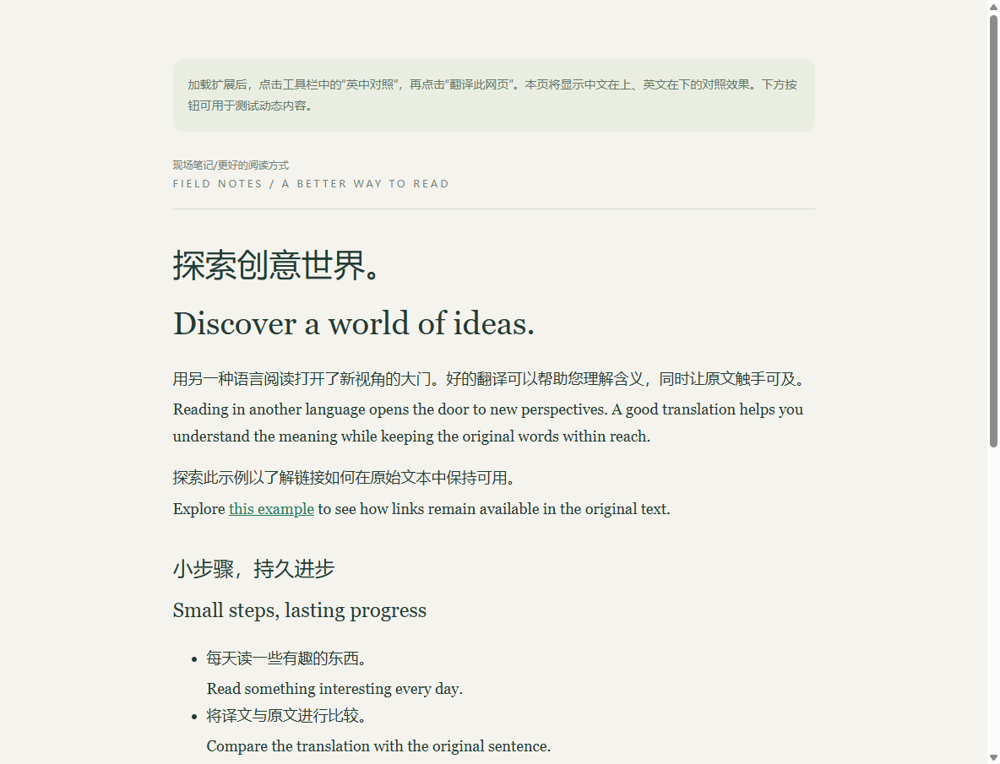

# 英中对照 · 网页翻译

将网页英文翻译成简体中文：**译文显示在原段落的位置，英文原文紧接在下方**。支持 Chrome 的 Manifest V3，无需构建、无需安装依赖。

```text
阅读另一种语言，可以打开通往新视角的大门。
Reading in another language opens the door to new perspectives.
```

下图使用真实 Google 译文，展示本扩展的网页排版效果：



[查看扩展弹窗预览](./popup-preview.png)

## 安装

1. 在 Chrome 地址栏打开 `chrome://extensions/`。
2. 开启右上角的“开发者模式”。
3. 点击“加载已解压的扩展程序”，选择本文件所在的 `chrome-bilingual-translator` 文件夹（其中包含 [manifest.json](./manifest.json)）。如果拿到的是 ZIP，请先解压。
4. 点击浏览器工具栏的拼图图标，把“英中对照 · 网页翻译”固定到工具栏。
5. 打开普通英文网页，点击扩展图标，再点击“翻译此网页”。

不需要安装 Node.js，也不需要 Google API Key。Edge 也可通过 `edge://extensions/` 加载，但主要面向 Chrome。

## 使用

- **翻译此网页**：中文在上，原文在下。按段落合并行内文字，原文中的链接、强调和点击事件保留。
- **滚动阅读**：优先翻译视口及附近段落，滚动后翻译后续内容，减少无效请求。
- **持续翻译新增内容**：处理滚动加载、文章内容更新和页面新增段落，可在弹窗中关闭。
- **恢复原文**：移除译文及扩展创建的文本包装；恢复后，未完成的请求不会重新插入译文。已经发出的 Google 请求仍可能完成。
- **重试失败内容**：连接失败时显示具体原因，恢复网络后点击重试。
- **快捷键**：`Alt+Shift+T` 切换翻译 / 原文。如有冲突，可在 `chrome://extensions/shortcuts` 修改。

翻译按钮只处理当前标签页，刷新或离开网页后需要重新开启。设置保存在本机。

## 演示

如果已安装 Node.js 22 或更新版本，在本文件夹运行：

```powershell
node tools/serve-demo.cjs
```

然后访问 <http://127.0.0.1:8765/demo.html>，使用已安装的扩展翻译。示例包括段落、标题、列表、链接、动态内容，以及应跳过的代码和输入框。

## 翻译服务及权限

默认使用 Google 网页翻译接口 `https://translate.googleapis.com/translate_a/single`，固定 `en → zh-CN`。这是非官方公开接口，没有稳定性或配额保证；服务可能变更、限流或不可达。**当前网络必须能访问这个域名**，Google 官方收费 Cloud Translation API 不包含在此版本中。正式商业发布时应换用有配额及服务保障的 API 和配套后端。

只有点击翻译或使用快捷键后，待翻译文本才发送至 Google；请求不携带网页 URL、网页 Cookie、表单输入或账号信息。正文中本来包含的个人信息也会随待翻译文本发送，请自行选择合适的网页。翻译结果仅在扩展后台的内存中缓存，最多 800 条，后台休眠或重启会清空，不保存网页内容到磁盘。

- `activeTab`、`scripting`：在用户操作的当前网页注入翻译逻辑。
- `storage`：保存“持续翻译新增内容”开关。
- `https://translate.googleapis.com/*`：访问 Google 翻译接口。

没有请求全站持续读取权限，也不自动翻译浏览记录中的其他网页。

## 范围

处理普通网页主文档中以英文为主的可见文本，保留现有 HTML，并在每个文本单元的顶部插入独立中文文本。中文译文不复制原文中的链接，链接可在下方英文中点击。英文原文字号遵循网页样式。

跳过代码、输入框、可编辑区域、隐藏内容、`translate="no"`、`.notranslate` 及明确标注为其他语言的段落。中英混合段落按英文字符占比决定是否翻译。非常长的独立文本节点（超过 12,000 字符）会跳过。

不支持图片里的文字、PDF、浏览器内置页、Chrome 扩展商店、iframe 和 Shadow DOM。复杂交互控件或固定高度布局可能容纳不下双语文字。页面自行重绘时，扩展会尝试重新翻译；如与网站冲突，可恢复原文或刷新。

## 开发与验证

没有第三方运行时或测试依赖。

```powershell
npm.cmd test
```

测试包括翻译服务的并发、缓存、失败重试，以及真实无头浏览器中的段落排版、DOM 保留、动态更新、恢复与迟到结果。浏览器测试自动寻找本机 Chrome / Edge，也可通过 `BILINGUAL_BROWSER_PATH` 指定可执行文件。自动化测试使用模拟译文，不消耗 Google 请求；真实翻译仍取决于网络和服务状态。

主要文件：[后台请求](./background.js)、[网页处理](./content.js)、[译文样式](./content.css)、[弹窗](./popup.html)。修改后在扩展管理页点击“重新加载”，并刷新测试网页。
